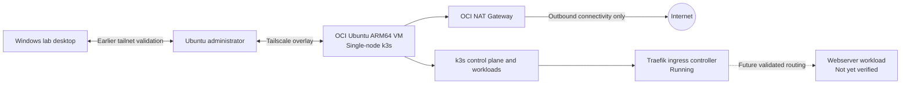

# Secure Kubernetes Webserver Lab — Oracle Cloud, Tailscale and k3s

Security-focused infrastructure lab migrated from local Windows/Ubuntu systems to an Oracle Cloud Infrastructure (OCI) VM. The aim is a **privately administered Kubernetes webserver** with reproducible verification and a transparent record of changes.

> **Current documented state (2026-11-09):** Ubuntu 26.04.1 LTS ARM64 OCI instance running a single-node **k3s v1.37.2+k3s1** cluster. The node reports **Ready**. Traefik is installed and running. Administrative SSH over Tailscale has been demonstrated. The OCI Internet Gateway used during bootstrap was subsequently removed, with NAT-based outbound access reported and tested. An NGINX pod and Service are Running, and the existing `nginx-ingress` explicitly selects the **Traefik** IngressClass. **HTTP 200 from the tailnet IP and a populated NGINX EndpointSlice are verified; the exact HTTP path through Traefik, DNS and HTTPS still need validation**.

## Current topology

The NAT Gateway permits outbound connections but does **not** accept unsolicited inbound internet connections. Tailscale supplies the private administration overlay. The OCI subnet is shown as *Public Subnet* in historical provisioning screenshots; **do not confuse this label with proof of current public VM exposure**. Confirm effective VNIC public-IP assignment, route tables, and OCI security rules before making definitive exposure claims.

## Milestones

| Phase | State | Evidence |
| --- | --- | --- |
| Local Windows ↔ Ubuntu Tailscale | Verified | Eight successful ICMP replies, machine status |
| OCI VCN, VM and initial SSH bootstrap | Completed (historical IGW path) | Earlier OCI and SSH screenshots |
| SSH over Tailscale to OCI VM | Verified | Tailnet ping and SSH login |
| NAT outbound path and removal of Internet Gateway | Reported/tested during migration | Cloud configuration screenshots and connection tests |
| k3s installation | Verified | Installer output |
| k3s single-node readiness | Verified | `kubectl get nodes -o wide` |
| Traefik controller and service | Verified running | `kubectl get pods -n kube-system`, `kubectl get svc traefik -n kube-system`, `kubectl get ingressclass` |
| NGINX Ingress resource | Verified present, class `traefik` | 2026-11-09 namespace-wide ingress inventory; HTTP route **not** yet proven |
| NGINX pod and Service | Verified Running / ClusterIP | 2026-11-09 all-pods and all-services inventory |
| HTTP access to NGINX via tailnet IP | Verified | 2026-11-09 `curl -I` returned HTTP 200 and NGINX server header |
| Traefik path, TLS and browser validation | Pending | Explicit Traefik routing test and HTTPS proof still required |
| Monitoring, backups and security review | Pending | — |

## Reusable manifests

- [NGINX ClusterIP Service](manifests/nginx-service.yaml) — sanitized declarative YAML from the observed live Service; port 80 forwards to targetPort 8080, selecting `app: nginx`. Deployment and Ingress manifests are pending source inspection.

## Documentation

- [Architecture and migration decisions](docs/architecture.md)
- [Tailscale deployment](docs/01-tailscale/README.md)
- [OCI network history and troubleshooting](docs/02-oracle-cloud/networking.md)
- [OCI SSH troubleshooting](docs/02-oracle-cloud/ssh-and-troubleshooting.md)
- [k3s installation and verification](docs/03-kubernetes/README.md)
- [Traefik and ingress status](docs/04-reverse-proxy/README.md)
- [Phase 5 — workload and Ingress verification](docs/04-reverse-proxy/phase-5-verification.md)
- [Evidence inventory and publication guidelines](screenshots/README.md)
- [Change history](CHANGELOG.md)

## Screenshot evidence

Previously committed proof remains under [screenshots/01-tailscale](screenshots/01-tailscale) and [screenshots/02-oracle-cloud](screenshots/02-oracle-cloud). Additional redacted November 2026 screenshots are cataloged in [the evidence index](screenshots/README.md); not all of those new binary images are uploaded to this repository yet.

**Publishing policy:** No private SSH keys, Tailscale authentication keys, identity-bearing hostnames, unredacted IP details, cloud OCIDs, account emails, or unredacted originals. Revoke any previously exposed authentication key even if its screenshot is later redacted.

## Roadmap

1. Verify that the existing `nginx-ingress` sends requests to the NGINX Service and ready endpoints through Traefik.
2. Deploy a minimal web workload, Service and explicit IngressClass; verify in-cluster routing.
3. Confirm only required private network access, and verify externally exposed ports are closed.
4. Implement TLS and DNS only after choosing a deliberate exposure model.
5. Add least-privilege controls, monitoring, backups and restore testing.

Documentation distinguishes **historical setup**, **observed results** and **planned tasks**. Do not interpret screenshots of an OCI creation form as proof of an applied resource.
