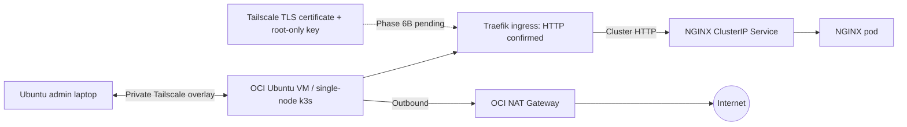

# Secure Kubernetes Webserver Lab — Oracle Cloud, Tailscale and k3s

Security-focused infrastructure lab migrated from local Windows/Ubuntu systems to an Oracle Cloud Infrastructure (OCI) VM. The aim is a **privately administered Kubernetes webserver** with reproducible verification and a transparent record of changes.

> **Current documented state (2026-11-11):** Oracle Cloud Ubuntu ARM64 VM with single-node k3s, working Traefik → NGINX HTTP routing, NAT egress and Tailscale private access. **Phase 6A complete:** Tailscale/Let's Encrypt certificate issued for the existing tailnet hostname; certificate and key are root-owned and mode `600`. **Traefik TLS termination and HTTPS client handshake are not configured/verified yet.**

## Current topology

The NAT Gateway permits outbound connections but does **not** accept unsolicited inbound internet connections. Tailscale supplies the private administration overlay. The OCI subnet is shown as *Public Subnet* in historical provisioning screenshots; **do not confuse this label with proof of current public VM exposure**. Confirm effective VNIC public-IP assignment, route tables, and OCI security rules before making definitive exposure claims.

## Milestones

| Phase | State | Evidence |
| --- | --- | --- |
| Local Windows ↔ Ubuntu Tailscale | Verified | Eight successful ICMP replies, machine status |
| OCI VCN, VM and initial SSH bootstrap | Completed (historical IGW path) | Earlier OCI and SSH screenshots |
| SSH over Tailscale to OCI VM | Verified | Tailnet ping and SSH login |
| NAT outbound path and removal of Internet Gateway | Reported/tested during migration | Cloud configuration screenshots and connection tests |
| k3s installation | Verified | Installer output |
| k3s single-node readiness | Verified | `kubectl get nodes -o wide` |
| Traefik controller and service | Verified running | `kubectl get pods -n kube-system`, `kubectl get svc traefik -n kube-system`, `kubectl get ingressclass` |
| NGINX Ingress resource | Verified, class `traefik` | 2026-11-10 Traefik-to-NGINX HTTP 200 |

| NGINX pod and Service | Verified Running / ClusterIP | 2026-11-09 all-pods and all-services inventory |
| HTTP access to NGINX via tailnet IP | Verified | 2026-11-09 `curl -I` returned HTTP 200 and NGINX server header |
| Traefik-to-NGINX routing | Verified | 2026-11-10 in-cluster curl to Traefik Service returned NGINX HTTP 200 |
| Tailscale hostname certificate (Phase 6A) | **Verified issued and protected** | 2026-11-11 CLI, OpenSSL metadata and `ls -l` |
| Traefik HTTPS, hostname and TLS handshake (Phases 6B–6C) | Pending | Certificate exists but is not yet configured in Traefik |
| Monitoring, backups and security review | Pending | — |

## Reusable manifests

- [NGINX Ingress (Traefik)](manifests/nginx-ingress.yaml) — observed wildcard-host HTTP `/` routing to `nginx-service:80`.
- [NGINX ClusterIP Service](manifests/nginx-service.yaml) — sanitized declarative YAML from the observed live Service; port 80 forwards to targetPort 8080, selecting `app: nginx`. Deployment and Ingress manifests are pending source inspection.

## Documentation

- [Architecture and migration decisions](docs/architecture.md)
- [Tailscale deployment](docs/01-tailscale/README.md)
- [OCI network history and troubleshooting](docs/02-oracle-cloud/networking.md)
- [OCI SSH troubleshooting](docs/02-oracle-cloud/ssh-and-troubleshooting.md)
- [k3s installation and verification](docs/03-kubernetes/README.md)
- [Traefik and ingress status](docs/04-reverse-proxy/README.md)
- [Phase 5 — workload and Ingress verification](docs/04-reverse-proxy/phase-5-verification.md)
- [Phase 6A — Tailscale HTTPS certificate and verification](docs/06-https-tls/phase-6a-certificate.md)
- [Monitoring and recovery (planned)](docs/07-monitoring/README.md)
- [Evidence inventory and publication guidelines](screenshots/README.md)
- [Change history](CHANGELOG.md)

## Screenshot evidence

Previously committed proof remains under [screenshots/01-tailscale](screenshots/01-tailscale) and [screenshots/02-oracle-cloud](screenshots/02-oracle-cloud). Phase 6A screenshot evidence was sanitized and prepared as a separate archive; its binary screenshots are not part of this commit. See [the evidence index](screenshots/README.md) for status.

**Publishing policy:** No private SSH keys, Tailscale authentication keys, identity-bearing hostnames, unredacted IP details, cloud OCIDs, account emails, or unredacted originals. Revoke any previously exposed authentication key even if its screenshot is later redacted.

## Roadmap

1. **Phase 6A complete:** certificate issued, dates/identity inspected and root-only file permissions verified.
2. **Phase 6B pending:** store the certificate in a namespace-scoped Kubernetes TLS Secret and enable the existing Traefik HTTPS Ingress.
3. **Phase 6C pending:** validate chain, live server hostname, TLS handshake, private Tailscale HTTPS response and public exposure boundaries.
4. **Phase 6D pending:** publish verified 6B–6C steps and sanitized screenshots.
5. Later: Cloudflare Tunnel/CDN/WAF integration with verified origin TLS; monitoring, backups and recovery.

Documentation distinguishes **historical setup**, **observed results** and **planned tasks**. Do not interpret screenshots of an OCI creation form as proof of an applied resource.
