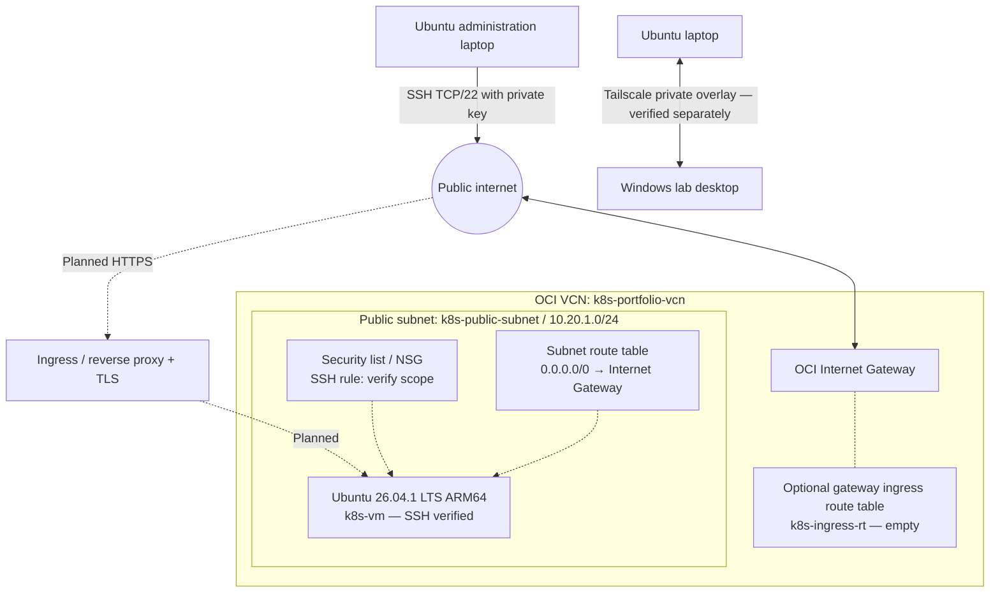

# Secure Kubernetes Webserver Lab — Oracle Cloud + Tailscale

A documented, security-focused infrastructure project built around **Oracle Cloud Infrastructure (OCI)** and a planned **Kubernetes-hosted webserver**. This repository began as a local Windows/Ubuntu homelab, then transitioned to an Oracle Cloud VM after local network/firewall instability. It includes **actual validation evidence**, a troubleshooting timeline, and explicit distinctions between completed and planned work.

> **Verified status (November 4, 2026):** Direct SSH using a local private key successfully reached an **Ubuntu 26.04.1 LTS ARM64** instance in OCI. The terminal shows `ubuntu@k8s-vm:~$`. This is proof of remote access, **not proof that Kubernetes, ingress, TLS, or a web application is already deployed**.

## Current architecture

**Security boundaries:** The Tailscale connection between local devices is **independent** of the OCI VM. Tailscale on OCI has **not** been verified; direct SSH currently uses the public-IP path. A public subnet and internet route do not automatically permit traffic: OCI security rules and host configuration also matter.

## Implementation milestones

| Stage | Deliverable | Evidence / state |
| --- | --- | --- |
| 01 | Local Ubuntu ↔ Windows Tailscale | **Verified**: devices connected and 8/8 ICMP replies |
| 02 | OCI VCN, public subnet and gateway routing | **Configured during troubleshooting**; validated by subsequent SSH login |
| 03 | Key-based SSH access to OCI Ubuntu VM | **Verified**: successful remote shell |
| 04 | Least-privilege SSH ingress, patching and host hardening | **Not yet independently verified** |
| 05 | Kubernetes installation / workload | **Not yet deployed or verified** |
| 06 | HTTPS ingress, DNS, TLS and public webserver | **Planned** |
| 07 | Observability, backups, maintenance | **Planned** |

## Evidence gallery

| Screenshot | What it shows |
| --- | --- |
| [Tailscale Linux interface](screenshots/01-tailscale/01-ubuntu-tailscale-interface.png) | Linux tailnet interface active |
| [8-packet ping](screenshots/01-tailscale/05-icmp-eight-packets.png) | Ubuntu ↔ Windows ICMP reachability |
| [Tailscale machine status](screenshots/01-tailscale/06-tailnet-devices.png) | Both devices connected |
| [OCI internet gateway form](screenshots/02-oracle-cloud/01-internet-gateway-creation-redacted.png) | Gateway setup form |
| [Original gateway route-table selection](screenshots/02-oracle-cloud/02-original-gateway-route-table-association-redacted.png) | Initial association that led to route-table confusion |
| [Dedicated ingress route table](screenshots/02-oracle-cloud/03-dedicated-ingress-route-table-redacted.png) | Separate gateway ingress table |
| [Ingress association](screenshots/02-oracle-cloud/04-dedicated-ingress-association-redacted.png) | Gateway ingress table selection |
| [Subnet default-route form](screenshots/02-oracle-cloud/05-public-subnet-default-route-form-redacted.png) | `0.0.0.0/0 → IGW` configuration entered |
| [**Successful SSH login**](screenshots/02-oracle-cloud/06-successful-ssh-redacted.png) | Ubuntu VM remote shell reached |

Screenshots have been selected for public sharing; **do not commit unredacted originals**. See [evidence policy](screenshots/02-oracle-cloud/README.md) for limitations of the edited images.

## Documentation

- [Current architecture and design decisions](docs/architecture.md)
- [OCI network configuration and explanations](docs/02-oracle-cloud/networking.md)
- [SSH success and troubleshooting](docs/02-oracle-cloud/ssh-and-troubleshooting.md)
- [Upcoming security work](docs/04-security/README.md)
- [Original Tailscale deployment](docs/01-tailscale/README.md) and [verification](docs/01-tailscale/verification.md)
- [Screenshot index](screenshots/02-oracle-cloud/README.md)

## Learning approach

Each phase documents **what**, **why**, **how**, **verification**, and **what remains unverified**. Do not confuse a screenshot of a configuration form with proof it was saved; use independently observed results when making completion claims.

## Security

Do not commit private keys, access tokens, authentication cookies, raw unredacted screenshots, real account identities, or public source IPs. Restrict SSH exposure to trusted administration addresses and verify NSG/security-list rules before calling the deployment hardened.
