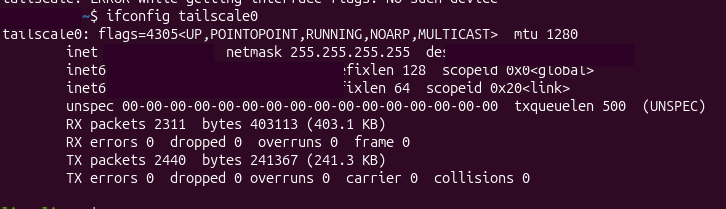
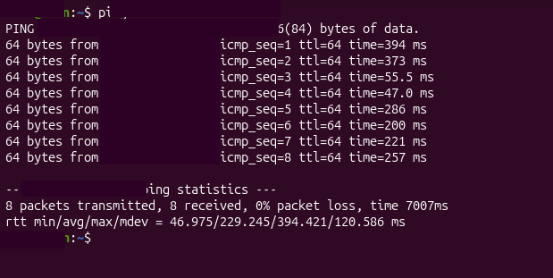
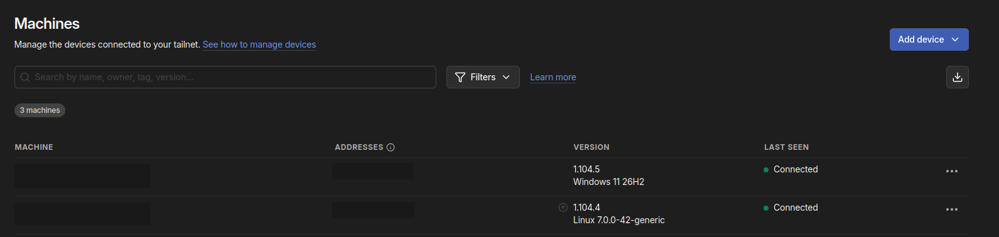

# Tailscale Verification Results

**Recorded:** November 3, 2026  
**Environment:** Ubuntu administration laptop ↔ Windows lab desktop  
**Scope:** Tailscale connection and ICMP reachability evidence; not an end-to-end security assessment.

## 1. Linux interface

The Ubuntu screenshot shows `ifconfig tailscale0`, with the Tailscale interface marked `UP` and `RUNNING` and RX/TX counters without reported errors.



> This shows a configured, running interface; it is not on its own proof of application connectivity.

## 2. ICMP connectivity test

Command used on Ubuntu (address redacted for public documentation):

```bash
ping -c 8 <WINDOWS_TAILSCALE_IP>
```

Observed output from the original screenshot:

| Metric | Observed result |
| --- | ---: |
| Packets transmitted | 8 |
| Packets received | 8 |
| Packet loss | 0% |
| Round trip min | 46.975 ms |
| Round trip average | 229.245 ms |
| Round trip max | 394.421 ms |
| Round trip standard deviation (mdev) | 120.536 ms |



**Interpretation:** The target responded to all eight ICMP requests in this single test. Latency varied considerably; the result does not guarantee consistently low-latency access or establish which Tailscale path (direct vs relay) was used. A native `tailscale ping` result has not yet been supplied as evidence.

## 3. Tailnet admin console

The captured Tailscale Machines page shows the **Windows desktop** and **Ubuntu laptop** with `Connected` indicators. The console also displays a count of three machines, but only two machine rows are visible in this capture.



## Acceptance criteria

- [x] Linux Tailscale interface observed UP/RUNNING
- [x] Windows and Ubuntu shown as connected on admin console
- [x] Eight ICMP packets transmitted and received with no loss
- [x] Screenshots redacted from original source images
- [ ] Native `tailscale ping` evidence captured (optional additional network-path check)
- [ ] Access policies/grants reviewed and documented
- [ ] Remote administration service (SSH/RDP) tested with least privilege

## Repeatable checks

```bash
# Ubuntu
sudo systemctl is-active tailscaled
tailscale status
tailscale ping <WINDOWS_TAILSCALE_IP>
ping -c 8 <WINDOWS_TAILSCALE_IP>
```

For Windows PowerShell, assuming the standard installation location:

```powershell
& "$env:ProgramFiles\Tailscale\tailscale.exe" status
```

Do not post raw command output publicly until hostnames, account information, and addresses have been reviewed.
