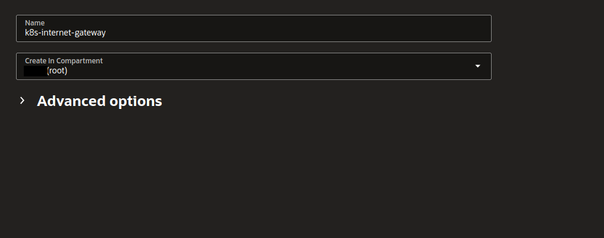
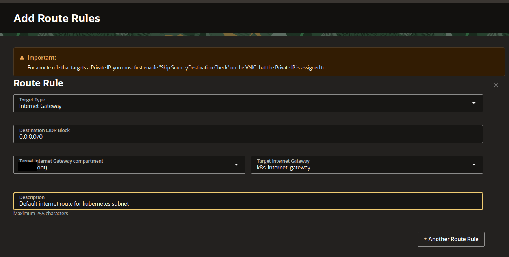
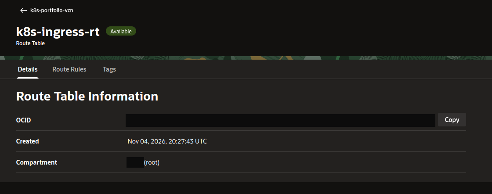
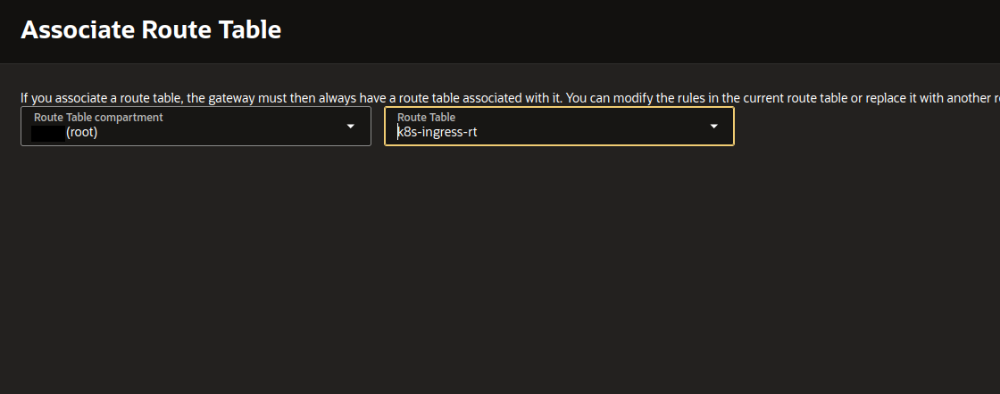
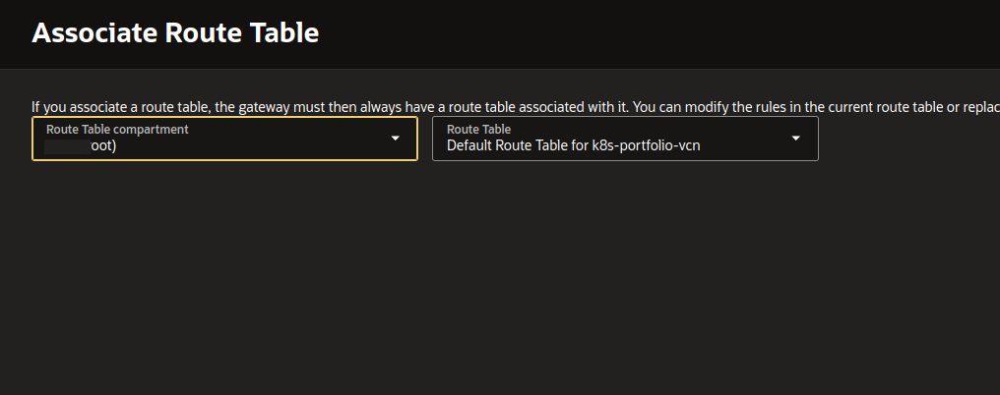

# OCI networking: public subnet, gateway and route rules

**Outcome:** A successful key-based SSH shell was observed after OCI networking changes on November 4, 2026. This page explains the configuration and why each part matters.

## Inventory

| Component | Name / value | Evidence |
| --- | --- | --- |
| VCN | `k8s-portfolio-vcn` | OCI console screenshots |
| Public subnet | `k8s-public-subnet` / `10.20.1.0/24` | OCI console screenshots during troubleshooting |
| Subnet route table | `Default Route Table for k8s-portfolio-vcn` | Associated on subnet details screen |
| Internet Gateway | `k8s-internet-gateway` | [Gateway form](../../screenshots/02-oracle-cloud/01-internet-gateway-creation-redacted.png) and [route form](../../screenshots/02-oracle-cloud/05-public-subnet-default-route-form-redacted.png) |
| Optional IGW ingress table | `k8s-ingress-rt` | [Table](../../screenshots/02-oracle-cloud/03-dedicated-ingress-route-table-redacted.png), [association](../../screenshots/02-oracle-cloud/04-dedicated-ingress-association-redacted.png) |

## Step A — Understand the public subnet

OCI marks `k8s-public-subnet` as public, which means it *can* host VNICs with public addresses. That alone does not configure a working internet path. A public IP on the instance, a default route through an enabled Internet Gateway, OCI traffic filtering rules, and a functioning guest service are also needed.

## Step B — Internet Gateway

The Internet Gateway is a VCN-level connectivity resource, not the same object as an ingress route table. OCI allows one Internet Gateway per VCN. The previously absent gateway was recreated as `k8s-internet-gateway`.



## Step C — Why there are two route tables

**Public subnet route table:** Used for normal VM-originated traffic. The relevant route is:

| Destination | Target type | Target |
| --- | --- | --- |
| `0.0.0.0/0` | Internet Gateway | `k8s-internet-gateway` |



`0.0.0.0/0` matches any IPv4 destination not handled by a more specific route. The route tells OCI where to forward packets, **not** which TCP port is allowed. A screenshot of the entry form alone doesn't prove that the rule was saved; the subsequent successful SSH login confirms end-to-end reachability at that time.

**Internet Gateway ingress route table (optional):** If associated, it controls advanced routing of *incoming* traffic, typically via a private-IP next hop to an appliance. For this project `k8s-ingress-rt` was kept empty. Do not add the outbound internet default route there.





### The OCI API error and its cause

During configuration, OCI returned:

```text
Rules in the route table must use private IP as a target.
Or the route table can be empty (no rules).
```

The original subnet route table had also been associated with the Internet Gateway as its ingress table. An IGW ingress table has different permitted route targets. We created a separate empty ingress table and kept the subnet default-route rule on the subnet-associated table.

The original mistaken selection is kept as **troubleshooting history**, not an example to copy:



## Step D — TCP/22 is a security rule, not a route

A route is selected by IP destination; it does not have a TCP port selector. To permit direct SSH, examine the subnet's security lists and any NSGs on the VM's VNIC. Add or adjust **ingress**, **stateful**, **TCP**, **destination port 22**, **source = trusted admin public IP `/32`**. In many instances an existing SSH ingress rule may already be present: inspect first and avoid duplicates.

**Verification outstanding:** The exact effective OCI security rule source range and OS firewall settings were not captured. Working SSH proves that some path was allowed during the test, **not** that the SSH rule is restricted to one administrator.

## Verification and next checks

1. Verify `k8s-internet-gateway` is enabled under VCN **Gateways**.
2. Verify `Default Route Table for k8s-portfolio-vcn` is the subnet's associated table and has one default route to the IGW.
3. Keep the IGW ingress table `k8s-ingress-rt` empty if attached.
4. Verify a public IPv4 address is attached to the intended VM VNIC (keep actual address out of the repository).
5. Inspect OCI security list/NSG rules for TCP/22 and reduce SSH exposure where possible.
6. Confirm an SSH login and capture redacted evidence; [successful connection](../../screenshots/02-oracle-cloud/06-successful-ssh-redacted.png).

## Concepts to explain in interviews

- An Internet Gateway supplies connectivity but does not automatically create subnet route rules.
- Subnet route tables and gateway ingress route tables serve **different traffic directions and purposes**.
- `0.0.0.0/0` routes IPv4 traffic; `TCP/22` is a **filtering**, not a routing, concern.
- A successful TCP three-way handshake does not mean an SSH application handshake or user authentication succeeded.
