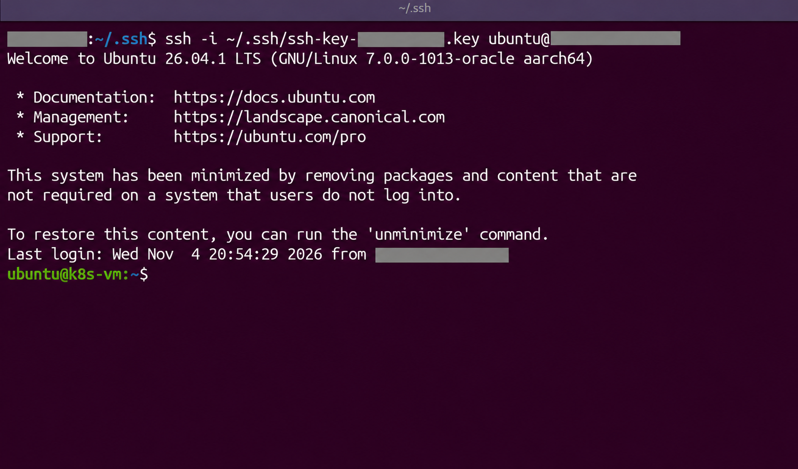

# SSH recovery and verified remote login

## Final observed result

On **November 4, 2026**, direct key-based SSH reached an OCI instance login shell. The server identified itself as **Ubuntu 26.04.1 LTS, aarch64 (ARM64)** and presented `ubuntu@k8s-vm:~$`.



The exhibit is an **edited illustration based on the captured terminal screenshot**, not a bit-for-bit original; see the [screenshot policy](../../screenshots/02-oracle-cloud/README.md). The unredacted original is intentionally excluded.

## Safe command template

```bash
chmod 600 ~/.ssh/<YOUR_PRIVATE_KEY>.key
ssh-keygen -y -f ~/.ssh/<YOUR_PRIVATE_KEY>.key > /dev/null
ssh -o IdentitiesOnly=yes -i ~/.ssh/<YOUR_PRIVATE_KEY>.key ubuntu@<VM_PUBLIC_IPV4>
```

- **`chmod 600`** protects private-key material from other local users; it was necessary because the key initially had mode `0664`.
- **`ssh-keygen -y`** validates that the private key can be parsed and derives the public key. It does **not** install that public key on the VM.
- **`IdentitiesOnly=yes`** limits SSH to the explicitly chosen identity.
- **`ubuntu`** is the working login user observed for this Ubuntu image. OCI's serial-console keys are not the same authorization path as normal VM SSH.

## Chronology of observed troubleshooting

| Observation | Interpretation |
| --- | --- |
| Initial local key had permissions `0664` | SSH refused to load an unprotected key; corrected to mode `0600` |
| `ssh-keygen -y` exited with status `0` | Local private key was readable and parseable |
| TCP port 22 accepted connections with `nc` | A network endpoint was reachable on TCP/22; **no SSH banner** appeared |
| `kex_exchange_identification: read: Connection reset by peer` | Connection ended **before authentication**; username guessing and key rotation were not justified by this result |
| OCI VCN routing table showed **0 route rules** | Public subnet's required default route was absent |
| OCI gateway list showed no Internet Gateway | A required internet-routing component was missing at that point |
| Attempting IGW target on a gateway-associated table produced a private-IP-only API error | Wrong kind of routing table was associated with the gateway |
| Separate ingress table and public subnet default route were configured | Correct separation of gateway ingress and outbound subnet routing |
| Normal SSH reached Ubuntu shell | **Verified** end-to-end SSH access |

**Causal qualification:** Multiple networking changes happened before successful login. The evidence shows missing routing/gateway configuration and a later working SSH session, but it does not isolate exactly which change resolved the earlier reset.

## Concepts learned

1. **Transport vs application:** `nc` success means TCP reachability, not that `sshd` completed a protocol handshake.
2. **SSH phases:** TCP setup → protocol identification → key exchange → user authentication → shell. A reset before server identification is not a rejected username.
3. **Identity separation:** A private key stays local; the corresponding public key must be authorized by the instance. OCI serial console connection keys do not automatically authorize regular SSH login.
4. **Cloud layering:** Public IP/VNIC mapping, IGW, subnet routes, OCI rules, host firewall, and `sshd` all affect reachability.

## After access: safe hardening sequence (pending)

Keep your current SSH session open before any changes. Inspect effective OCI SSH ingress first, and test new restrictions using **a second session** so you do not lock yourself out. Next record OS version (`cat /etc/os-release`), SSH service status (`systemctl status ssh`), current listening ports (`sudo ss -tlnp`), and firewall status (`sudo ufw status verbose` or distribution equivalent). Do **not** claim these checks have already passed.
