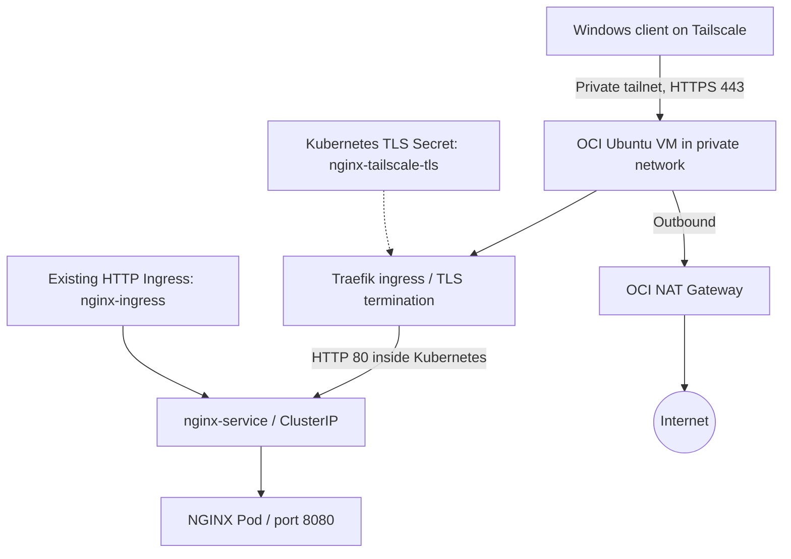

# Phase 6 — Private HTTPS/TLS with Tailscale Certificates and Traefik

**Project:** Secure Kubernetes Webserver — Oracle Cloud Infrastructure (OCI)  
**Deployment and verification:** November 11–12, 2026  
**Status:** **HTTPS deployed and verified from a separate Windows tailnet client.**

This **single Phase 6** document combines certificate issuance, Kubernetes Secret creation, Traefik HTTPS routing, client TLS tests, the Tailscale Serve conflict and resolution, security precautions, and GitHub evidence. It replaces the former 6A–6D documentation pages.

## 1. Intended network and TLS architecture



- Tailscale secures the private overlay connection and supplies MagicDNS for the `.ts.net` hostname.
- **Traefik**, not Tailscale Serve, terminates application HTTPS using a Tailscale-obtained Let's Encrypt certificate.
- The deployment uses Tailscale as its private client-access path; Tailscale Funnel was not enabled.
- The original HTTP route remained configured. This phase did not enforce an HTTP-to-HTTPS redirect.
- The existing NGINX workload, Service and K3s/Traefik installation were preserved.

## 2. Obtain and protect the TLS certificate

On the OCI Ubuntu server, create a root-owned directory (if not already present), read the **existing** Tailscale FQDN, and export the certificate and private key:

```bash
sudo install -d -m 700 -o root -g root /etc/tailscale/certs

TS_HOST="$(tailscale status --json | python3 -c 'import json,sys; print(json.load(sys.stdin)["Self"]["DNSName"].rstrip("."))')"

sudo tailscale cert \
  --cert-file=/etc/tailscale/certs/k8s-vnic.crt \
  --key-file=/etc/tailscale/certs/k8s-vnic.key \
  "$TS_HOST"

sudo chmod 600 /etc/tailscale/certs/k8s-vnic.crt
sudo chmod 600 /etc/tailscale/certs/k8s-vnic.key
```

**Observed:** Tailscale reported both files written; `ls -l` showed `root:root` ownership and `-rw-------` for both. Root-only permissions on these host files do not automatically protect the Kubernetes copy of the key.

Inspect only public certificate metadata (never print/publish the private key):

```bash
sudo openssl x509 -in /etc/tailscale/certs/k8s-vnic.crt \
  -noout -subject -issuer -dates -ext subjectAltName
```

| Field | Verified result |
|---|---|
| Issuer | Let's Encrypt, E2 |
| Subject and SAN | Exact existing `.ts.net` server FQDN (redacted here) |
| Valid from (UTC) | 2026-11-11 14:14:34 |
| Expires (UTC) | **2027-02-09 14:14:33** |
| On-host key ownership and mode | `root:root`, `600` |

Evidence: [certificate issuance](../../screenshots/06-https-tls/01-tailscale-cert-generation-redacted.webp), [permission commands](../../screenshots/06-https-tls/02-cert-file-permissions-redacted.webp), [certificate metadata](../../screenshots/06-https-tls/03-openssl-certificate-details-redacted.webp), [permission verification](../../screenshots/06-https-tls/04-cert-files-ls-redacted.webp).

## 3. Import certificate into Kubernetes

Run on the OCI VM:

```bash
sudo k3s kubectl create secret tls nginx-tailscale-tls \
  --cert=/etc/tailscale/certs/k8s-vnic.crt \
  --key=/etc/tailscale/certs/k8s-vnic.key \
  --namespace=webserver

sudo k3s kubectl get secret nginx-tailscale-tls -n webserver
```

**Observed:**

```text
secret/nginx-tailscale-tls created
NAME                  TYPE                DATA
nginx-tailscale-tls   kubernetes.io/tls   2
```

The TLS Secret must be in the same `webserver` namespace as the Ingress that references it. An initial namespace-less lookup returned NotFound; adding `-n webserver` correctly located the Secret. Never commit `kubectl get secret -o yaml` or the base64-encoded `tls.key` entry.

Evidence: [Secret creation](../../screenshots/06-https-tls/05-kubernetes-tls-secret-created.webp), [Secret metadata verification](../../screenshots/06-https-tls/06-kubernetes-tls-secret-verified.webp).

## 4. Configure Traefik HTTPS without replacing HTTP

A **second Ingress** was created using the already-installed Traefik controller and existing `nginx-service:80`. The original `nginx-ingress` was left intact.

```bash
# TS_HOST must contain the actual existing machine FQDN; re-read it if using a new shell.
TS_HOST="$(tailscale status --json | python3 -c 'import json,sys; print(json.load(sys.stdin)["Self"]["DNSName"].rstrip("."))')"

cat <<EOF | sudo k3s kubectl apply -f -
apiVersion: networking.k8s.io/v1
kind: Ingress
metadata:
  name: nginx-https-ingress
  namespace: webserver
  annotations:
    traefik.ingress.kubernetes.io/router.entrypoints: websecure
    traefik.ingress.kubernetes.io/router.tls: "true"
spec:
  ingressClassName: traefik
  tls:
    - hosts:
        - ${TS_HOST}
      secretName: nginx-tailscale-tls
  rules:
    - host: ${TS_HOST}
      http:
        paths:
          - path: /
            pathType: Prefix
            backend:
              service:
                name: nginx-service
                port:
                  number: 80
EOF
```

**Why:** `websecure` selects Traefik's HTTPS entrypoint, the TLS annotation enables HTTPS routing, and `secretName` associates the certificate with the hostname. The Ingress backend still targets the NGINX ClusterIP Service on port 80.

**Observed:** `ingress.networking.k8s.io/nginx-https-ingress created`. The following commands confirmed an Ingress class of `traefik`, host-specific TLS using `nginx-tailscale-tls`, and backend `nginx-service:80` resolving to an NGINX endpoint on port 8080. Both the new and original HTTP Ingress were present.

```bash
sudo k3s kubectl get ingress -n webserver
sudo k3s kubectl describe ingress nginx-https-ingress -n webserver
```

Evidence: [Ingress creation](../../screenshots/06-https-tls/07-traefik-https-ingress-created.webp), [Ingress inventory](../../screenshots/06-https-tls/08-ingress-inventory.webp), [Ingress description](../../screenshots/06-https-tls/09-https-ingress-description.webp). A variable-based [HTTPS manifest template](../../manifests/nginx-https-ingress.yaml.tpl) is committed without the identifying FQDN; it must be expanded before use.

## 5. Verify certificate deployment and HTTPS

**OCI server certificate checks:** OpenSSL SHA-256 certificate fingerprints matched in all three locations: the original exported Tailscale certificate, the `webserver/nginx-tailscale-tls` Secret, and the certificate actually presented on the HTTPS listener when contacted from the server. The full fingerprint is omitted to minimize fingerprinting metadata in public documentation; the matching results were reported directly by the operator.

**OCI self-connection test (2026-11-12):** `curl -vI https://<redacted>.ts.net/` negotiated TLS 1.3, validated the Let's Encrypt chain and Subject Alternative Name, selected HTTP/2, and returned `HTTP/2 200` with `Server: nginx/1.30.6`. This alone did not establish remote reachability because the command was run on the OCI VM.

**Remote Windows test before Serve cleanup:** Windows resolved the hostname to a Tailscale `100.x` address and `Test-NetConnection -Port 443` passed over the Tailscale interface, but Schannel and the browser initially failed HTTPS. The NGINX page loaded over plain HTTP, which was **not** accepted as HTTPS validation.

### Tailscale Serve conflict and corrective action

The OCI VM reported an **old Tailscale Serve** mapping:

```text
https://[REDACTED-OLD-HOST].ts.net (tailnet only)
|-- / proxy http://127.0.0.1:8080
```

That proxy was unrelated to our desired Traefik TLS-termination path. An attempt to disable the 443 handler with `tailscale serve --https=443 off` returned `handler does not exist`. The operator then ran:

```bash
sudo tailscale serve reset
sudo tailscale serve status
```

**Observed:** No Serve configuration remained. The reset removes Serve mappings, **not** the Tailscale VPN. No Funnel was enabled. Given that Windows HTTPS worked afterward, the old Serve configuration was the **likely source of interference**; we did not capture an independent packet-level proof of exactly which listener handled every earlier failed request.

### Final remote Windows validation (2026-11-12)

The following command was run **directly in Windows PowerShell**, not over SSH:

```powershell
curl.exe -vI https://YOUR_HOSTNAME.YOUR_TAILNET.ts.net/
```

Relevant sanitized result:

```text
* Host [REDACTED].ts.net:443 was resolved.
* IPv4: [REDACTED TAILSCALE ADDRESS]
* Trying [REDACTED]:443...
* ALPN: server accepted http/1.1
* Established connection to [REDACTED].ts.net ([REDACTED]:443)
* using HTTP/1.x
> HEAD / HTTP/1.1
< HTTP/1.1 200 OK
< Content-Type: text/html
< Server: nginx/1.30.6
< Content-Length: 896
```

No `-k` / `--insecure` was used. The Windows browser also loaded the NGINX welcome page and reported **“Connection Is Encrypted”** for the server. Together these provide remote-client HTTPS evidence. Note that the Windows Schannel output did not explicitly print the complete chain verification details; certificate/hostname verification was independently confirmed from the OCI Linux tests.

Evidence: [redacted Windows encrypted browser screenshot](../../screenshots/06-https-tls/10-windows-browser-https-encrypted.webp). The Windows PowerShell `curl.exe` success is preserved in the sanitized transcript above.

## 6. Verification results

| Check | Status |
|---|---|
| Tailscale/Let's Encrypt certificate generated and protected | ✅ Verified |
| Kubernetes TLS Secret (`webserver`) imported | ✅ Verified |
| Traefik HTTPS Ingress and NGINX backend configured | ✅ Verified |
| Correct live certificate presented (matching fingerprints) | ✅ Verified on OCI VM |
| Trusted TLS 1.3 / HTTP/2 and NGINX response | ✅ Verified on OCI VM |
| Windows client HTTPS over tailnet / browser encryption | ✅ Verified |
| Stale Tailscale Serve mapping removed | ✅ Confirmed by empty Serve status |

The certificate was issued for the lab's Tailscale hostname and presented by Traefik during the verified HTTPS connection.

## 7. Security and lifecycle recommendations

- Keep TLS private keys, raw `kubernetes.io/tls` Secret data, cloud identifiers and unredacted screenshots out of version control. Secret values are not safe merely because they are base64 encoded.
- Limit Secret access with Kubernetes RBAC and consider K3s datastore encryption-at-rest and secure backup handling.
- Renew the certificate before **February 9, 2027, 14:14:33 UTC**. Updating the certificate on disk also requires updating the Kubernetes TLS Secret and verifying the served certificate.
- The original HTTP Ingress remains configured alongside the HTTPS Ingress, as shown in the resource inventory.
- Maintain the documented private Tailscale access path, with Funnel disabled.

## 8. GitHub evidence and redaction

All embedded images are minimally redacted copies of authentic screenshots. Masked areas are limited to identifying hostnames, terminal usernames/host prompts, and Tailscale/private IP details; the visible functional command results have not been fabricated. No certificate key bytes or Kubernetes Secret payloads are embedded. See the [evidence index](../../screenshots/06-https-tls/README.md).

**Phase 6 result:** Working private HTTPS via Traefik, demonstrated from a separate Windows tailnet client.
