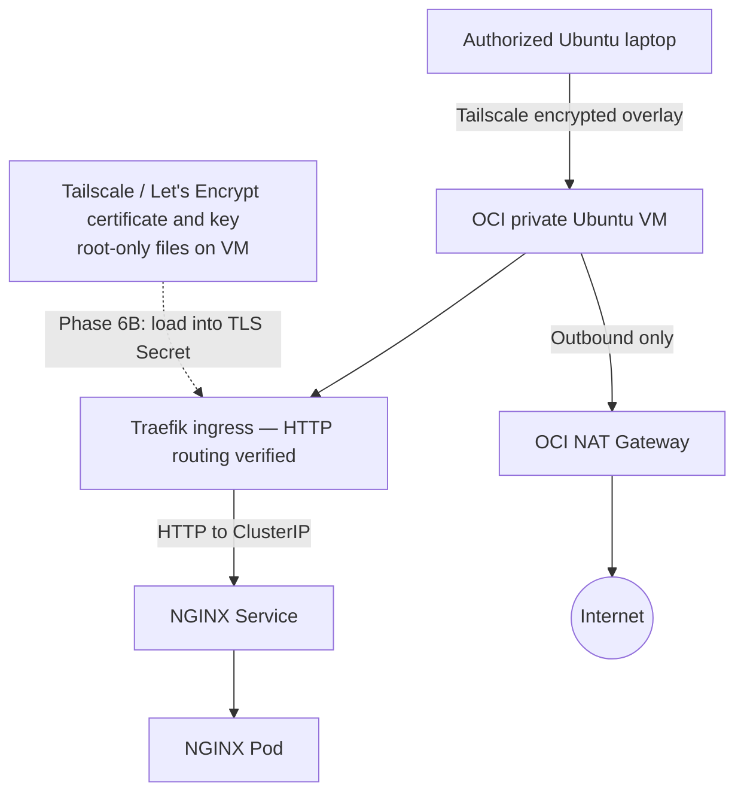

# Phase 6A — Tailscale HTTPS certificate issued and verified

**Project:** Secure Kubernetes Webserver — Oracle Cloud Infrastructure  
**Evidence date:** 2026-11-11  
**Status:** **Phase 6A verified.** Traefik HTTPS configuration (6B) and client TLS validation (6C) have **not** yet been deployed or verified.

## Purpose and trust boundaries

The OCI Ubuntu VM stays privately administered over Tailscale. A Tailscale-issued, publicly trusted Let's Encrypt certificate will authenticate the existing `.ts.net` hostname when Traefik later terminates TLS. The Tailnet overlay already encrypts transport between authorized devices; the new certificate is for **application-layer server authentication and HTTPS** at Traefik. Traefik-to-NGINX can remain HTTP inside the cluster for this lab.



**Not yet active:** No claim is made here that Traefik serves HTTPS, that a browser trusts the live endpoint, or that an independent external exposure audit has passed. Tailscale Funnel must remain disabled.

## Certificate generation — observed success

The host's existing `.ts.net` FQDN was passed to `tailscale cert`. The generated files were written to:

- **Public certificate / chain:** `/etc/tailscale/certs/k8s-vnic.crt`
- **Private key (never commit):** `/etc/tailscale/certs/k8s-vnic.key`

The screenshots show the CLI reporting **“Wrote public cert”** and **“Wrote private key”** with those paths. No raw certificate or private-key bytes are published.

### Reproducible command sequence (do not replace the existing files without a renewal plan)

Create a root-controlled directory if necessary:

```bash
sudo install -d -m 700 -o root -g root /etc/tailscale/certs
```

Retrieve the existing Tailscale FQDN without exposing it in a public repository:

```bash
TS_HOST="$(tailscale status --json | python3 -c 'import json,sys; print(json.load(sys.stdin)["Self"]["DNSName"].rstrip("."))')"
```

Issue/export the certificate to protected paths:

```bash
sudo tailscale cert \
  --cert-file=/etc/tailscale/certs/k8s-vnic.crt \
  --key-file=/etc/tailscale/certs/k8s-vnic.key \
  "$TS_HOST"
```

Set file permissions:

```bash
sudo chmod 600 /etc/tailscale/certs/k8s-vnic.crt
sudo chmod 600 /etc/tailscale/certs/k8s-vnic.key
```

**Command rationale:** `install -d` creates the root-owned directory with owner-only access; `tailscale status --json` reads the machine's current FQDN; `tailscale cert` uses Tailscale's HTTPS certificate workflow without public VM ingress; `chmod 600` restricts both files to root.

## Verification — observed on 2026-11-11

Certificate metadata was inspected using:

```bash
sudo openssl x509 \
  -in /etc/tailscale/certs/k8s-vnic.crt \
  -noout -subject -issuer -dates -ext subjectAltName
```

| Item | Observed result |
| --- | --- |
| Subject CN | Existing `k8s-webserver.[redacted].ts.net` hostname |
| Subject Alternative Name | DNS name matches existing Tailscale hostname |
| Issuer | `C=US, O=Let's Encrypt, CN=E2` |
| Not Before (UTC) | `2026-11-11 14:14:34 GMT` |
| Not After (UTC) | `2027-02-09 14:14:33 GMT` |
| Certificate permissions | `-rw-------` (`600`), `root:root` |
| Private key permissions | `-rw-------` (`600`), `root:root` |
| Certificate file present | Yes, `k8s-vnic.crt` |
| Private key file present | Yes, `k8s-vnic.key` |

File ownership and permissions were observed using `ls -l` from the certificate directory. The observed command output contains no private-key contents.

**Interpretation:** These results verify issuance, matching identity metadata, validity dates, and on-disk protections. The `openssl x509` display command alone is **not** a validation of the certificate chain, a TLS server handshake, or TLS configuration in Traefik. Those tests belong to Phase 6C.

## Evidence inventory and redaction

Four original terminal screenshots were reviewed:

1. Successful `tailscale cert` output (issuance paths).
2. `chmod 600` on certificate and key.
3. `openssl x509` subject / issuer / dates / SAN.
4. `ls -l` confirming root ownership and mode `600`.

Before publication, the original FQDN and terminal host identifiers must be **masked**. Never publish key content, a raw Kubernetes Secret, Tailscale auth tokens, complete identifying tailnet names, cloud identifiers, or unredacted original images. Redacted image binaries were prepared separately; **the screenshots are not included in this repository commit**.

See [screenshot evidence index](../../screenshots/README.md) for the repository's image-commit status.

## Operational considerations

- **Renewal:** The observed certificate expires on **2027-02-09 at 14:14:33 UTC**. A repeatable certificate refresh and Kubernetes TLS Secret replacement/reconciliation workflow is necessary before that date; this is **not automated yet**.
- **Credential handling:** Restrict private-key file access and Kubernetes Secret access through filesystem permissions and RBAC. A Kubernetes Secret is not automatically encrypted at rest; assess cluster datastore encryption and backups before production use.
- **Hostname privacy:** Publicly trusted certificates may reveal FQDNs in Certificate Transparency logs even when the VM is reachable only through Tailscale.
- **Tailscale:** Keep MagicDNS and private access as configured; do not enable Funnel.
- **OCI:** Retain the private networking/NAT design. A successful certificate request is not proof of no external exposure; that requires a separate exposure review.
- **Cloudflare (future):** Cloudflare Tunnel, CDN, and WAF are **not deployed**. Select and verify origin certificate trust and SNI for the future public/origin hostname. Do not permanently disable TLS verification.

## Next checkpoint — Phase 6B

Create a TLS Secret in the **`webserver`** namespace from the existing cert/key files and update the **existing** Traefik Ingress to use port 443 and the matching FQDN while continuing to route to `nginx-service:80`. Preserve the running workloads, and verify TLS endpoints before marking 6B complete. Do **not** commit a Secret YAML containing `tls.crt` or `tls.key`.
