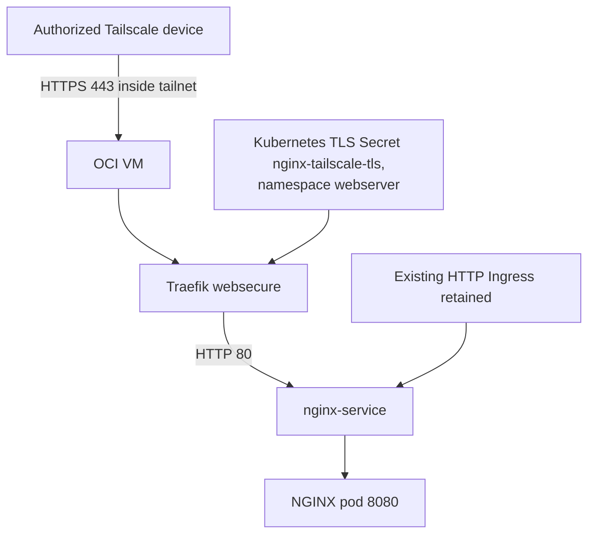

# Phase 6B — Traefik HTTPS Ingress configuration

**Evidence date:** 2026-11-11  
**Status:** **VERIFIED — Kubernetes TLS Secret and HTTPS Ingress configuration.** Live TLS is separately verified in [Phase 6C](phase-6c-validation.md).

## Objective and architecture

Preserve the original `nginx-ingress` (HTTP), `nginx-service` and NGINX pod. Add a separate `nginx-https-ingress` using the existing Traefik controller and the `websecure` entrypoint on 443. Kubernetes routes to `nginx-service:80`; no extra proxy controller, application, OCI public endpoint or Tailscale Funnel is deployed.



## Step 1 — Create Kubernetes TLS Secret

The certificate and private key were obtained and stored with `root:root` permissions in [Phase 6A](phase-6a-certificate.md). On the OCI host:

```bash
sudo k3s kubectl create secret tls nginx-tailscale-tls \
  --cert=/etc/tailscale/certs/k8s-vnic.crt \
  --key=/etc/tailscale/certs/k8s-vnic.key \
  --namespace=webserver
```

**Observed:** `secret/nginx-tailscale-tls created`.

Verify existence **without displaying any Secret data**:

```bash
sudo k3s kubectl get secret nginx-tailscale-tls -n webserver
```

**Observed:** `nginx-tailscale-tls`, `TYPE kubernetes.io/tls`, `DATA 2`. An initial query without `-n webserver` returned NotFound; the namespace-qualified query succeeded. The Ingress and TLS Secret must reside in the same namespace.

## Step 2 — Add host-specific HTTPS Ingress

The existing Tailscale FQDN was obtained programmatically rather than hardcoded in GitHub:

```bash
TS_HOST="$(tailscale status --json | python3 -c 'import json,sys; print(json.load(sys.stdin)["Self"]["DNSName"].rstrip("."))')"
```

The command actually applied to Kubernetes:

```bash
cat <<EOF | sudo k3s kubectl apply -f -
apiVersion: networking.k8s.io/v1
kind: Ingress
metadata:
  name: nginx-https-ingress
  namespace: webserver
  annotations:
    traefik.ingress.kubernetes.io/router.entrypoints: websecure
    traefik.ingress.kubernetes.io/router.tls: "true"
spec:
  ingressClassName: traefik
  tls:
    - hosts:
        - ${TS_HOST}
      secretName: nginx-tailscale-tls
  rules:
    - host: ${TS_HOST}
      http:
        paths:
          - path: /
            pathType: Prefix
            backend:
              service:
                name: nginx-service
                port:
                  number: 80
EOF
```

**Observed:** `ingress.networking.k8s.io/nginx-https-ingress created`.

The annotations select Traefik's `websecure` entrypoint and enable TLS; the `tls.secretName` associates the certificate with the requested hostname, and the backend remains the original Service. See the [sanitized YAML template](../../manifests/nginx-https-ingress.yaml.tpl). **The template has a variable and must not be applied unexpanded.**

## Step 3 — Verify Ingress resource

```bash
sudo k3s kubectl get ingress -n webserver
sudo k3s kubectl describe ingress nginx-https-ingress -n webserver
```

| Observed field | Result |
| --- | --- |
| Ingress | `nginx-https-ingress` created |
| Original Ingress | `nginx-ingress` still present |
| Ingress Class | `traefik` |
| TLS Secret | `nginx-tailscale-tls` |
| Host / SAN | Current `.ts.net` FQDN matches issued cert |
| HTTPS annotation | `router.entrypoints: websecure` |
| TLS annotation | `router.tls: true` |
| Backend | `nginx-service:80`, NGINX endpoint port 8080 |
| Ports | New Ingress reports 80,443; original reports 80 |
| Events | `<none>` |

**Interpretation:** The Secret, host rule, backend and Traefik routing resources are correctly configured. An Ingress showing port 443 is not *alone* proof of a live handshake. See the subsequently verified real TLS test in [Phase 6C](phase-6c-validation.md).

## Security notes and pending lifecycle

- No private keys, Secret manifests, base64 Secret contents, identifying tailnet hostnames or raw certificates are committed.
- Root-only host files are separate from Kubernetes Secret security; review Secret RBAC, datastore-at-rest encryption and backups.
- Certificate expires **2027-02-09 14:14:33 UTC**. A renewal procedure must update both on-host files and the namespace-scoped Secret and revalidate Traefik's live certificate. Renewal is **not automated yet**.
- The original HTTP Ingress stays active; HTTP redirects are a deliberate later choice.
- Tailscale Funnel must stay disabled. Configuration screenshots do not establish an independent OCI public exposure audit.

**Phase 6B: COMPLETE (configuration).** Evidence screenshots were supplied; sanitized text findings are published here without raw identifying IPs or hostnames.
