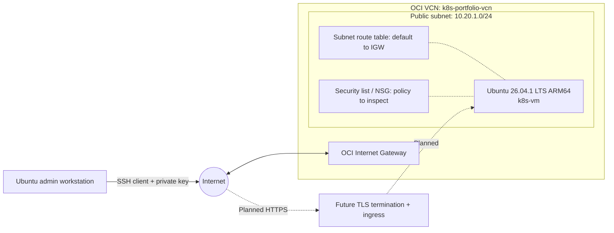
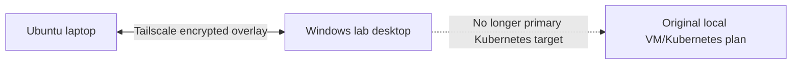

# Architecture and Decisions (Cloud Migration)

## Current deployed path (verified SSH)

- **Observed:** SSH command reached a `ubuntu@k8s-vm` shell (2026-11-04). The VM reports Ubuntu 26.04.1 LTS, ARM64 (`aarch64`).
- **Observed in OCI UI:** public subnet CIDR `10.20.1.0/24`, named `k8s-public-subnet`, associated with `Default Route Table for k8s-portfolio-vcn`. The original table was empty; a new default route was subsequently entered.
- **Observed during build:** An Internet Gateway was missing and the default route had not been configured. An Internet Gateway was recreated, and routing was corrected before successful SSH. The exact individual cause of each earlier connection reset was not isolated conclusively.
- **Not yet evidenced:** Kubernetes cluster, web workload, HTTPS, DNS, OCI-side Tailscale, least-privilege SSH ingress.

## Separate, earlier local management lab

Tailscale between Windows and Ubuntu was validated independently with 8/8 ICMP replies. It should not be depicted as an installed management tunnel to OCI.

## Routing versus filtering versus authentication

| Layer | Question | In this lab |
| --- | --- | --- |
| Routing | Where should packets be forwarded? | Subnet `0.0.0.0/0 → Internet Gateway` |
| Security controls | Is TCP/22 permitted from this source? | OCI security list / NSG, plus guest host firewall, **review pending** |
| Transport | Can a TCP session be established? | Earlier TCP port 22 test succeeded without SSH banner |
| SSH protocol | Does the server exchange SSH banners and negotiate keys? | Initially failed; later successful |
| Identity | Is the login account/key authorized? | Key-based login to `ubuntu` succeeded |

**Important:** The optional route table associated *with the Internet Gateway* is an **ingress route table**, not the public subnet's route table. If associated, it can remain empty for this design; adding `0.0.0.0/0 → IGW` to that gateway ingress table is incorrect. The default route belongs in the **public subnet's associated route table**.

## Security direction and next decisions

1. Restrict TCP/22 to trusted admin IP `/32` in the applicable OCI security list or NSG; inspect effective rules before changing them.
2. Verify OS firewall/SSH settings **without locking out the active session**. Keep one session open during changes and test a second connection.
3. Patch Ubuntu after checking operational impact; record package and service versions.
4. Choose and document Kubernetes distribution suitable for the ARM64 cloud VM.
5. Deploy an example service, choose ingress/TLS, then verify HTTPS externally.
6. Revisit Tailscale-to-OCI administration only as a separately planned and tested enhancement.

## Project history

The OPNsense firewall trial was abandoned due to instability. The Windows desktop remains part of an earlier Tailscale exercise, while OCI is the active target for the webserver lab. Do not claim local firewall, a deployed Kubernetes cluster, or OCI Tailscale access exists.
