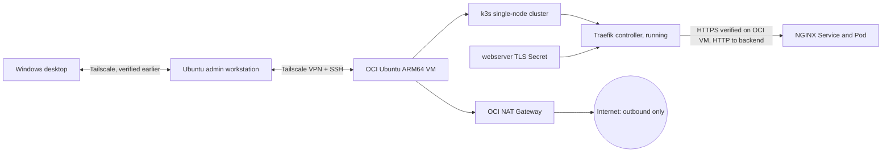

# Architecture and network migration decisions

## Current private administration model

The initial OCI connectivity path used a temporary **Internet Gateway** and key-based public SSH. The design was migrated to **Tailscale-based SSH** and **NAT for outbound connectivity**. The user subsequently confirmed successful remote access after the gateway transition and removal of the Internet Gateway. The NAT Gateway does not permit unsolicited inbound connections.

## Historical OCI build phase

The original VCN (`10.20.0.0/16`) and subnet (`10.20.1.0/24`) screenshots show a subnet labeled *Public Subnet* and temporary internet gateway route selections. These depict the **bootstrap/troubleshooting timeline**, not the intended current egress path. The ingress gateway route table and the subnet route table are separate concepts.

## Current Kubernetes state

- Ubuntu 26.04.1 LTS / ARM64 guest (observed).
- k3s v1.37.2+k3s1, one Ready control-plane node (observed).
- Traefik controller/pods and service running (observed).
- NGINX Service and pod running; Traefik-selected Ingress and HTTP 200 routing confirmed on 2026-11-10.
- Tailscale certificate for current `.ts.net` hostname **issued 2026-11-11** and stored with root-only access.
- `webserver/nginx-tailscale-tls` and `nginx-https-ingress` deployed and verified via kubectl on 2026-11-11; old HTTP Ingress retained.
- TLS 1.3 certificate chain/SAN validation and HTTP/2 200 from NGINX observed on 2026-11-12, **from OCI VM only**.
- Remote laptop access, public exposure audit and automatic certificate/Secret renewal are pending.

## Security boundaries

- Tailnet encryption does not replace authentication/authorization, host firewall policy or Kubernetes RBAC.
- NAT egress differs from an inbound Internet Gateway. Removing the gateway alone is not an audit of all external exposure paths.
- Review VNIC public IP, OCI security list/NSG rules, gateway attachments, firewall, Tailnet ACLs and any Tailscale Funnel/Serve configuration.
- Keep real authentication keys, private keys, full cloud OCIDs and account identity out of GitHub.
- A previously displayed Tailscale authentication key should be revoked if still valid.

## Next architecture checkpoint

Verify the HTTPS endpoint **from the separate Tailscale-connected laptop**, and independently verify public isolation/Funnel state. Phase 6B is complete and 6C is partially verified. Future Cloudflare Tunnel must validate origin TLS hostname/SNI and trust.
