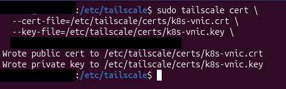
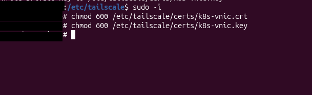
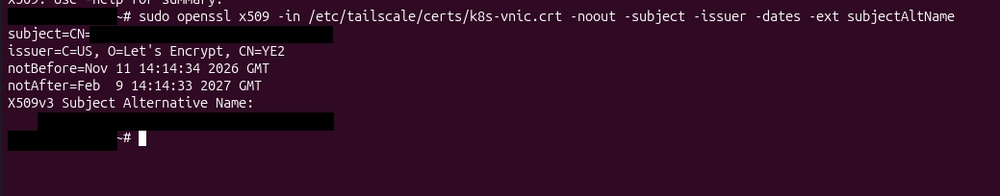
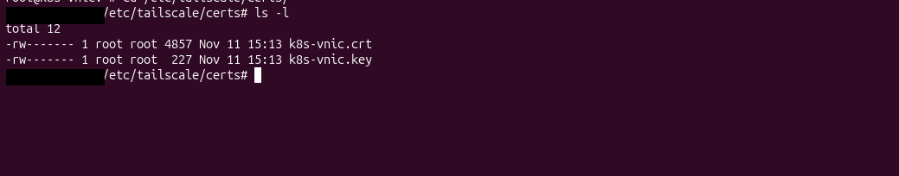
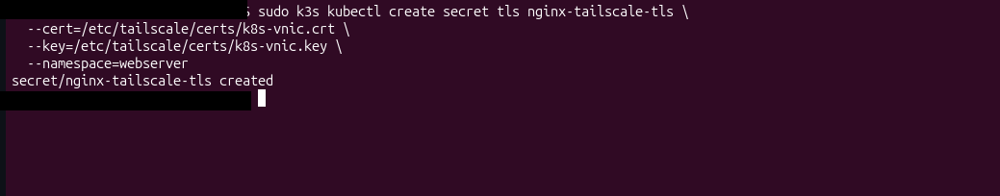
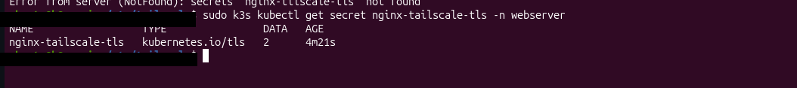
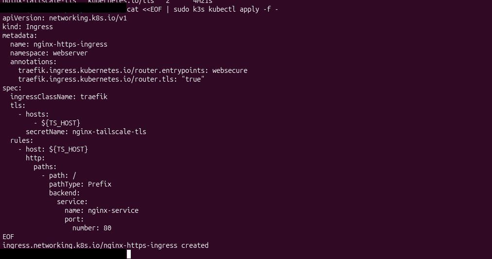
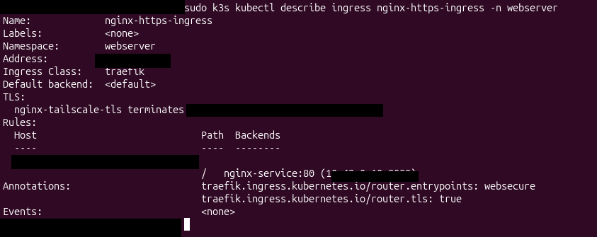
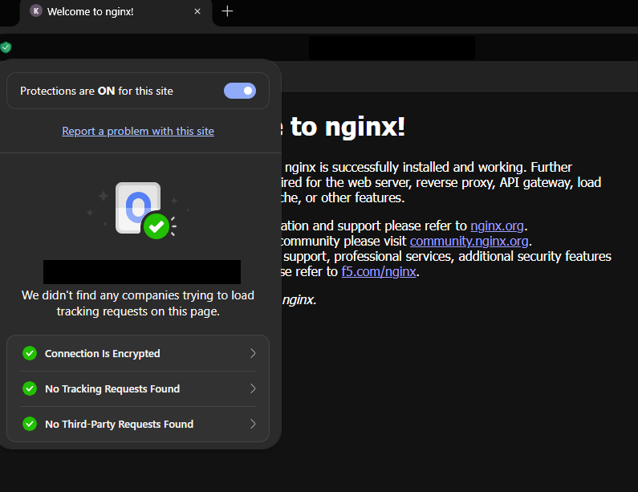

# Phase 6 — Verified redacted screenshot evidence

Authentic terminal and browser screenshots captured during November 11–12, 2026. Only identifying details (tailnet FQDN, host/user prompt and IP addresses) were blacked out; command and result text remains from the originals. No screenshots were fabricated and no Secret values/private keys were published.

### 1. Certificate and private-key file creation

### 2. Mode 600 applied to certificate and private key

### 3. Let's Encrypt E2 issuer, subject and validity dates

### 4. Owner root/root and mode 600 verified

### 5. Kubernetes Secret successfully created

### 6. Kubernetes TLS Secret type and DATA 2 verified

### 7. Traefik HTTPS Ingress created

### 8. Both HTTPS and original HTTP Ingress present

### 9. Traefik TLS Secret, hostname and NGINX backend

### 10. Windows browser reports Connection Is Encrypted

The final Windows PowerShell `curl.exe -vI` output was provided as terminal text, not a screenshot; its redacted transcript is in [Phase 6](../../docs/06-https-tls/README.md). The Tailscale Serve status/reset evidence was also provided as terminal text. An independent internet exposure audit has not been performed.
